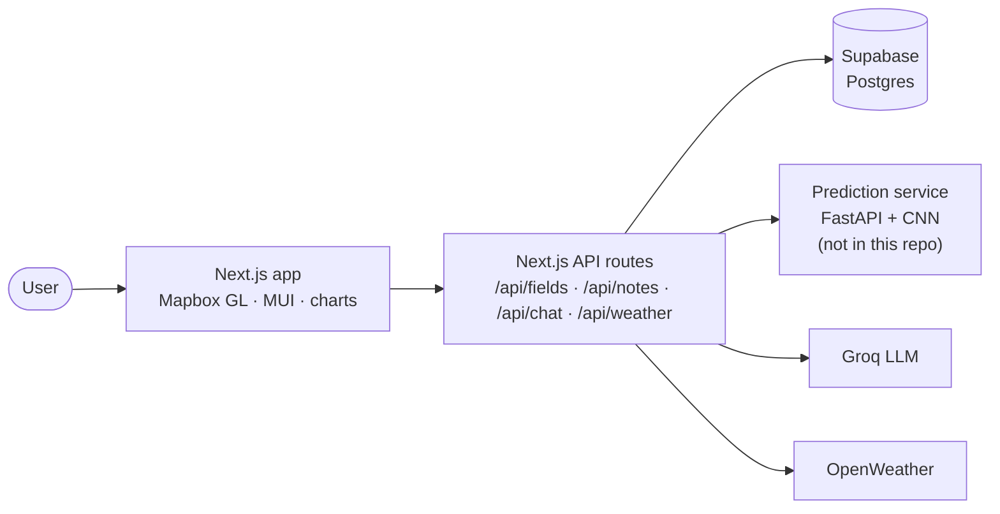

# Crop Yield Predictor

[](https://github.com/Muddasirr/crop-yield-predictor/actions/workflows/ci.yml)

Crop yield estimates for Pakistani farmland from satellite imagery. Farmers, researchers and planners draw a field on a map, get a predicted yield in kg/ha, and can ask an agriculture chatbot about it in plain language.

**Live:** https://satellite-based-crop-yield-predictor.vercel.app

> **Note:** on the live site, adding a new field fails, because the prediction model service isn't deployed (see [Limitations](#limitations-and-roadmap)). Browsing, charts, notes, weather and the chatbot work.

## Why we built it

There was no open, localized crop-yield model for Pakistan. Landsat imagery is free and covers the whole country every 16 days, so a model that reads crop health from it can give field-level estimates during the growing season.

## Features

- **Draw your field:** draw a polygon on a Mapbox map. The app reverse-geocodes the location and stores the field with its area and predicted yield.
- **Yield prediction:** a CNN trained on Landsat red and near-infrared bands with district-level yield data (see the model section below).
- **Agriculture chatbot:** ask questions in natural language (Groq, `gemma2-9b-it`). It refuses topics outside agriculture.
- **Dashboard:** charts across your fields, per-field notes, and a weather forecast for the field's location.
- **Accounts:** sign-up and login, with users stored in Supabase and passwords hashed with bcrypt.

## Architecture



### The model

- **Data:** multi-year Landsat imagery over the growing season, division by division across Pakistan, mainly Band 4 (red) and Band 5 (near-infrared), paired with recorded yields in kg/ha (typically 2,000–2,500 kg/ha).
- **Network:** a VGG-style CNN for regression: 11 convolutional layers in four blocks (`3×3 conv → BatchNorm → ReLU → Dropout`), stride-2 convolutions instead of max-pooling, a 1024×16×16 final feature map, a 2,048-unit dense layer and one linear output.
- **Result:** RMSE of 11% on held-out data.
- **Docs:** [Software Requirements Specification](https://www.overleaf.com/read/wjrczkthrrpc#1c0eb4) · [System Design](https://www.overleaf.com/read/hnnxdkxhwyjt#e40bdf)

## Getting started

**Prerequisites:** Node 20, a Supabase project, and a Mapbox token. The chatbot and weather need Groq and OpenWeather keys.

```bash
npm install
cp .env.example .env.local     # fill in the values below
npm run dev                    # http://localhost:3000
```

| Variable | Used for |
|---|---|
| `NEXT_PUBLIC_SUPABASE_URL`, `NEXT_PUBLIC_SUPABASE_ANON_KEY` | Database |
| `NEXT_PUBLIC_MAPBOX_ACCESS_TOKEN` | Map and reverse geocoding |
| `GROQ_API_KEY` | Chatbot (server-side) |
| `OPENWEATHER_API_KEY` | Weather (server-side) |

Check it builds with `npm run build`; CI runs the same build on every push and PR.

## Challenges and what we learned

- **Keep API keys on the server.** The first version called OpenWeather from the browser with the key in the code. Weather now goes through `/api/weather`, so no key reaches the client.

## Limitations and roadmap

- **The prediction service isn't deployed.** `src/pages/api/fields/createfield.js` posts to a hard-coded local-network address (`http://192.168.5.104:8000/predict`), so new fields can't get predictions on the live site, and the model code isn't in this repo. Next step: add the FastAPI model service, deploy it, and read its URL from an env var.
- Predictions are made for 2024 only (the year is hard-coded).
- `requirements.txt` is a full `pip freeze` of a development environment saved in UTF-16, so `pip install -r` fails on most systems. It should be replaced with the model service's real dependencies.
- There are no automated tests yet. CI only checks that the app builds.

## Team

- [Muddasir Rizwan](https://github.com/Muddasirr)
- [Muhammad Hadi](https://github.com/Theycallmeinsane)
- [Ahmed Raza](https://github.com/Ahmeddraaza)
- [Moeen Haider](https://github.com/MoeenH)
- Hasan Atiq

## License

All rights reserved by the authors listed above.
